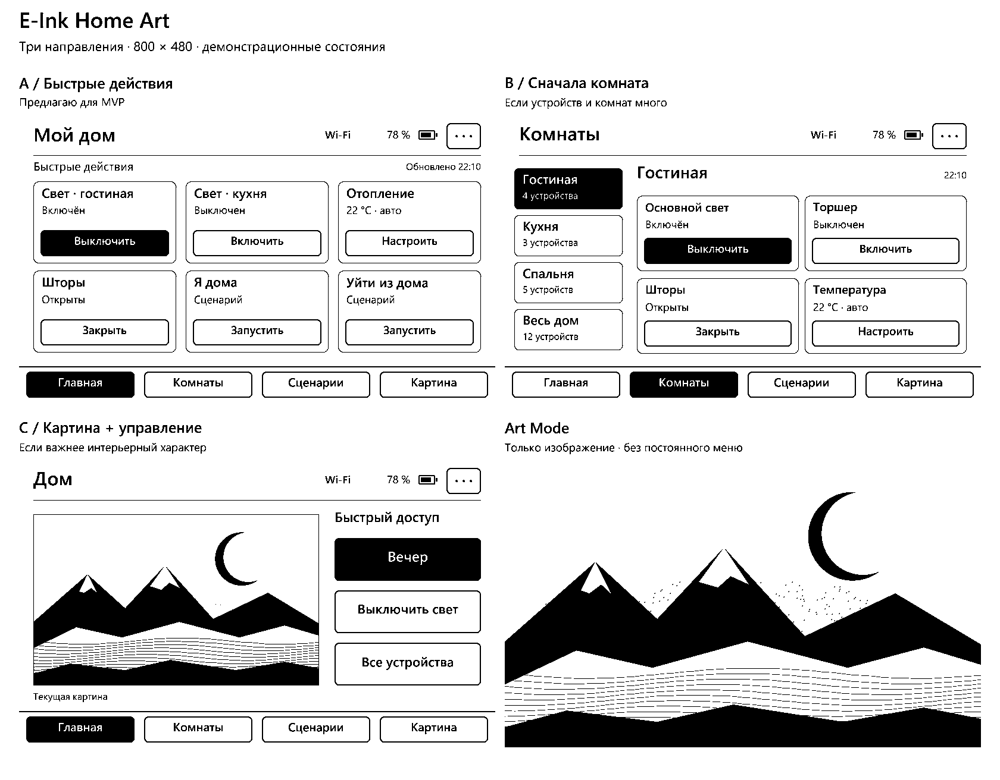

# Предложение интерфейса E-Ink Home Art / Revision 1

Статус: **макеты для согласования, не утверждённое изменение ТЗ и не прошивка**.

Обновление решений 19.11.2026: пользователь выбрал **четыре уровня серого для
Art Mode, обработку на клиенте и хранение только готового кадра на устройстве**.
Это закрывает прежний вопрос 1 bpp / 4 gray ниже. Текущий план:
[IMPLEMENTATION_PLAN.md](../../docs/IMPLEMENTATION_PLAN.md).

Основание: предоставленный пользователем `D:/DOWNLOADS/file/eink_home_art_TZ_rev1.md`.
Его неизменённая копия находится в [reference-tz-rev1.md](reference-tz-rev1.md).
Полный разбор: [analysis.md](analysis.md). Просмотр всех экранов: [index.html](index.html).



| Вариант | Сценарий | Компромисс |
|---|---|---|
| **A — Быстрые действия, предлагается для MVP** | Частые устройства и сценарии на одном экране; комнаты доступны отдельно | На первом экране помещается шесть действий; состав надо выбрать |
| **B — Сначала комната** | Выбор комнаты слева, четыре устройства справа | Иногда нужно дополнительное нажатие; для длинного списка нужны страницы |
| **C — Картина + управление** | В Smart Home Mode остаётся превью картины и несколько действий | Меньше доступных действий; это отдельный макет меню, не Art Mode |

## Все рендеры

Каждый экран — **800×480, PNG 1 бит/пиксель**. Рядом есть редактируемый SVG.
Процент заряда, названия, время и состояния — демонстрационные данные.
Это визуальные макеты: кнопки не подключены к реальным устройствам.

- [01-home-a.png](renders/01-home-a.png) / [SVG](renders/01-home-a.svg) — главный экран A.
- [02-home-b.png](renders/02-home-b.png) / [SVG](renders/02-home-b.svg) — главный экран B.
- [03-home-c.png](renders/03-home-c.png) / [SVG](renders/03-home-c.svg) — главный экран C.
- [04-art.png](renders/04-art.png) / [SVG](renders/04-art.svg) — Art Mode без элементов управления.
- [05-device.png](renders/05-device.png) / [SVG](renders/05-device.svg) — управление яркостью.
- [06-pending.png](renders/06-pending.png) / [SVG](renders/06-pending.svg) — ожидание команды без анимации.
- [07-offline.png](renders/07-offline.png) / [SVG](renders/07-offline.svg) — нет сети, сохранённые состояния.
- [08-settings.png](renders/08-settings.png) / [SVG](renders/08-settings.svg) — настройки MVP.

## Требует согласования

1. Главный экран: A, B или C. Рекомендация — **A**, комнаты по схеме B как отдельный раздел.
2. Регуляторы: кнопки, предустановки и «Применить» вместо непрерывного слайдера.
3. Возврат к картине: **45 секунд**, в пределах диапазона 30–60 секунд исходного ТЗ.
4. Art Mode первого MVP: чёрно-белая графика / фотографии с dithering либо отдельная реализация четырёх уровней серого. Сейчас драйвер использует только 1 bpp.
5. Настройка Wi-Fi/авторизации на панели или через телефон. Телефонный поток здесь только предложен в анализе; на рендерах он не представлен как готовая функция.

Сами макеты не добавляют в MVP Reader Mode, Home Assistant, док-станцию, расписания картин или редактор плана дома.

## Воспроизведение

`render.py` создаёт изображения программно из текста и векторных примитивов.
Нужны Python, Pillow и шрифты Windows Segoe UI / Georgia. Использован bundled
workspace Python с Pillow; AI-генерация изображений не использовалась.

```powershell
python design/ui-rev1/render.py
```

Генератор проверяет размеры и границы текста, минимальную высоту кнопок 44 px
и монохромность PNG. [manifest.json](renders/manifest.json) содержит размеры
и границы текстовых блоков. Макеты просмотрены визуально; это не проверка
настоящих касаний, сети, сна или отображения на физической панели.
