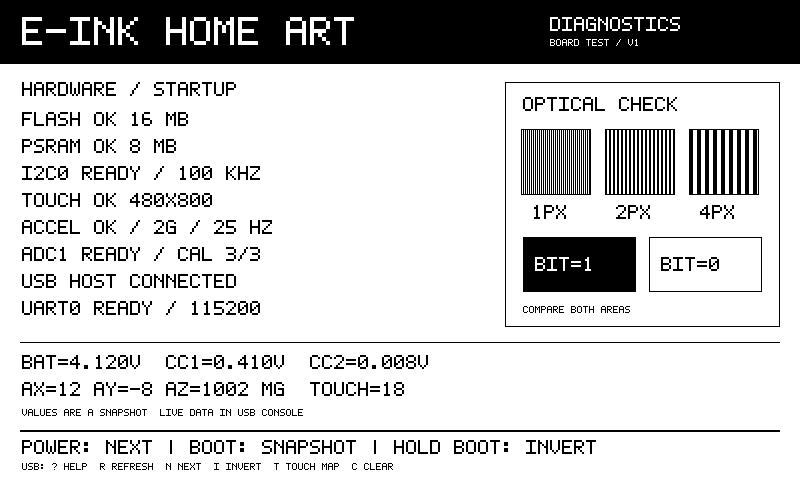
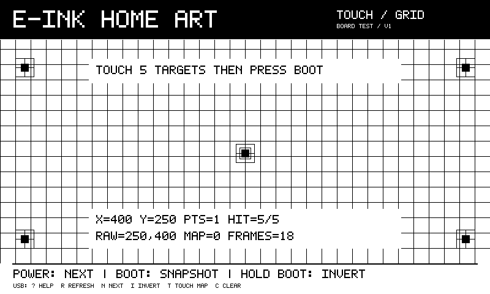

# Первый запуск собранной платы

Это диагностическая прошивка для ESP32-S3 N16R8 и панели GDEY075T7-T01.
Она запускает GPIO, SPI, общую I²C, драйверы панели/touch/акселерометра и ADC.
Тест аппаратно ещё не выполнялся. Превью ниже получены тем же C-рендерером
на компьютере; числа и успешные статусы в них — примеры.



## Сборка и прошивка

В терминале с активированным ESP-IDF 6.1, из корня проекта:

```sh
idf.py build
idf.py -p PORT flash monitor
```

`PORT` — реальный COM-порт платы, например `COM7`. Если требуется вручную
войти в загрузчик: удерживать BOOT, нажать и отпустить RESET, затем отпустить BOOT.
BOOT здесь — GPIO0, RESET — EN. Выход из монитора ESP-IDF: `Ctrl+]`.

Для прошивки собранным объединённым файлом, содержащим загрузчик, таблицу
разделов и приложение, из того же окружения:

```sh
python -m esptool --chip esp32s3 -p PORT write-flash 0x0 build/E-InkHomeArt-diagnostics.bin
```

После изменения исходников этот файл нужно пересоздать:

```sh
idf.py build merge-bin -o E-InkHomeArt-diagnostics.bin
```

Имя после `merge-bin -o` задаётся относительно каталога сборки; результат
этой команды находится в `build/E-InkHomeArt-diagnostics.bin`.

## Что произойдёт при включении

1. ESP-IDF проверит и подключит PSRAM. Прошивка рассчитана на N16R8: ошибка
   памяти на этой стадии отображается в загрузочном логе ещё до запуска теста.
2. Приложение сверит объём Flash 16 МБ и PSRAM 8 МБ, проверит шаблоном блок PSRAM 32 КБ.
3. Начнёт мигать D6: около полсекунды включён, полсекунды выключен.
4. На общей I²C проверит GT911 (`0x5D`) и LIS2DW12 (`0x19`).
5. Запустит LIS2DW12: ±2 g, 25 Гц, data-ready на INT1/GPIO39.
6. Настроит ADC1 батареи и CC1/CC2, попробует заводскую калибровку ESP32-S3.
7. Покажет диагностический экран и переведёт E-Ink в сон.

В USB-консоли появится `DIAGNOSTICS READY`, затем каждые пять секунд — `LIVE`.
Если дисплей или один из I²C-модулей отсутствует, консоль и остальные проверки
продолжают работать. Ожидание BUSY дисплея ограничено 20 секундами, операции
GT911 — 100 мс. Автоматической перезагрузки нет. После исправления монтажа
перезапустите плату; кнопка обновления снимка сама не пересоздаёт I²C-устройства.
Если уже запущенный LIS2DW12 ответил ошибкой I²C, опрос продолжится раз в секунду;
успешное чтение восстановит статус. В `LIVE` поля `accel_status` и `valid`
показывают ошибку и наличие достоверного последнего результата: при `valid=0`
цифры XYZ не следует считать действующим измерением.

## Кнопки и команды

Кнопки используются после запуска приложения: удержание BOOT при сбросе
переводит ESP32 в загрузчик, а не управляет экраном.

| Действие | Результат |
| --- | --- |
| POWER, короткое нажатие | Следующая страница и запрос её показа |
| BOOT, короткое нажатие | Снимок текущих показаний на экран |
| BOOT, удержание 1,5 с | Инверсия всего изображения |
| POWER, удержание 1,5 с | Очистка истории касаний/мишеней и новый снимок |
| USB `r` | Снимок/повтор передачи на дисплей |
| USB `n` | Следующая страница |
| USB `i` | Инверсия изображения |
| USB `t` | Следующий из восьми вариантов ориентации touch; очистка мишеней |
| USB `c` | Очистка истории касаний и мишеней |
| USB `?` | Справка |

В USB достаточно одного символа, Enter необязателен. В UART0 те же команды
отправляются отдельной строкой — один символ и Enter.

Экран обновляется **только по запросу**, автоматически на каждое касание или
изменение ускорения не мигает. Между обновлениями — минимум 10 секунд;
если нажать раньше, запрос подождёт, более свежий запрос заменит предыдущий.
Статусы на экране соответствуют моменту запроса, актуальные данные идут в консоль.
После каждой передачи панель уходит в deep sleep.

Интервал 10 секунд предназначен для короткой проверки собранной платы.
Для длительной эксплуатации следует увеличить его по рекомендациям панели:
[Good Display рекомендует паузы между полными обновлениями и сон после обновления](https://www.good-display.com/news/238.html).
Параметр доступен в `menuconfig → E-InkHomeArt diagnostics`.

## Пять страниц

1. **Диагностика:** Flash, PSRAM, I²C, GT911, LIS2DW12, ADC, USB и UART;
   напряжения батареи/CC и последний XYZ в mg. Справа — вертикальные полосы
   шириной 1/2/4 пикселя и противоположные заливки.
2. **Touch / Grid:** сетка и пять мишеней. Коснитесь всех мишеней, затем
   нажмите BOOT: попадания станут заполненными, счётчик должен показать `HIT=5/5`.
3. **BIT0 / White:** сплошные нулевые биты, проверка однородности заливки.
4. **BIT1 / Black:** противоположная заливка.
5. **Checker:** шахматные клетки 16×16 пикселей с центральной подписью.

Визуальная полярность родных байтов панели проверяется при первом запуске.
Если весь интерфейс показан негативом, удерживайте BOOT или отправьте `i`.
Заливки не имеют кнопочных подсказок, но управление продолжает работать.



## Проверка сенсора и датчиков

- GT911 не перезаписывает свою конфигурацию: нативное разрешение читается
  из контроллера. Портретная геометрия автоматически меняет оси для 800×480.
  Если движение зеркально или оси неверны, переберите `t` и проверьте все мишени.
  В консоли видны исходные `raw` и преобразованные `mapped` координаты.
- `FRAMES`/`TOUCH` — число новых прочитанных кадров с касаниями, а не число отдельных нажатий.
  Удержание пальца может увеличить счётчик многократно. Доступно до пяти точек.
- У неподвижного LIS2DW12 величина результирующего ускорения ожидается около
  1000 mg; при повороте платы меняются соответствующие оси. Счётчик `INT1`
  показывает замеченные переходы линии data-ready, обработчик ISR не устанавливается.
- Батарея измеряется через делитель ×2; CC1/CC2 — с коэффициентом ×1.
  Это напряжения, не проценты заряда и не определение мощности USB-C.
  Если калибровка ADC недоступна, вместо напряжений будет `--`, а исходные
  значения `adc_raw` останутся в консоли. Значение `mv=-1` означает отсутствие результата.
- `UART0 READY` подтверждает настройку интерфейса. Для проверки проводников
  подключите USB–UART 3,3 В: RX адаптера к J2.2/TX43, TX к J2.1/RX44,
  общую землю — к GND платы. Раз в пять секунд передаётся `LIVE`.
  Можно также замкнуть J2.1–J2.2 для loopback и смотреть рост `UART_RX` через USB;
  возврат телеметрии не исполняется как команды и не создаёт бесконечное эхо.

GPIO18/Q2 в тесте остаётся в 0, управление режимом зарядника не переключается.
`E-Ink transfer complete` подтверждает выполнение передачи и ожидания BUSY,
но изображение проверяется глазами: SPI дисплея не имеет обратного чтения.

## Программная проверка без платы

```sh
python tools/check_drivers.py
```

Команда собирает настоящие C-драйверы UC8179, GT911, LIS2DW12 и регистровый
код ST с имитацией SDK. Девять сценариев проверяют ошибки выделения памяти,
отсутствие устройств, неверный ID/размер сенсора, тайм-аут BUSY/reset,
ошибки I²C/SPI, передачу полного кадра частями, сон/пробуждение и новые касания.
Нужен Clang для компьютера; Windows-версия автоматически ищет LLVM из Visual
Studio (компонент C++ Clang tools for Windows) и `lld-link`. Пути можно задать
через `--compiler` и `--linker`. Python-пакеты и ESP-IDF для этой команды не нужны.
Результаты и превью сохраняются в `build/host-review/`; тесты не входят в прошивку.

`tools/preview_diagnostics.py` запускает настоящий C-рендерер, собранный как
библиотека для компьютера. Проверяет границы буфера, заливки, инверсию,
64 преобразования углов для восьми ориентаций и попадания в мишени; создаёт PNG.
Готовая DLL для компьютера не нужна ESP32 и не входит в прошивку.

`pytest_diagnostics.py` — отдельная проверка загрузки и появления `LIVE` для
подключённой ESP32-S3 с pytest-embedded. Подготовка в отдельном Python-окружении:

```sh
python -m venv .venv-test
.venv-test/Scripts/python -m pip install -r requirements-test.txt
.venv-test/Scripts/python -m pytest --collect-only -q pytest_diagnostics.py
```

На Linux/macOS путь к Python — `.venv-test/bin/python`. Сбор теста (`collect-only`)
проверен без платы. Чтобы выполнить его на собранной плате после `idf.py build`:

```sh
.venv-test/Scripts/python -m pytest --embedded-services=esp,idf --target=esp32s3 --port=PORT pytest_diagnostics.py
```

Этот аппаратный тест прошивает и перезапускает подключённое устройство.
Он ещё не выполнялся. Итоги программной перепроверки: [RECHECK.md](RECHECK.md).
