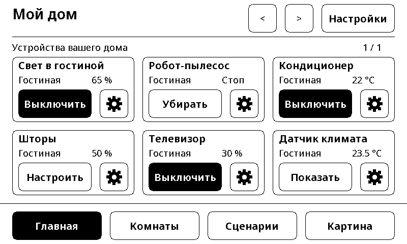
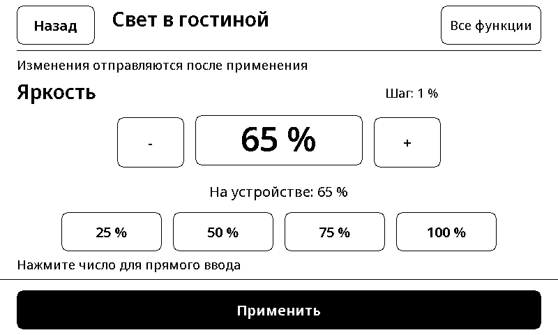
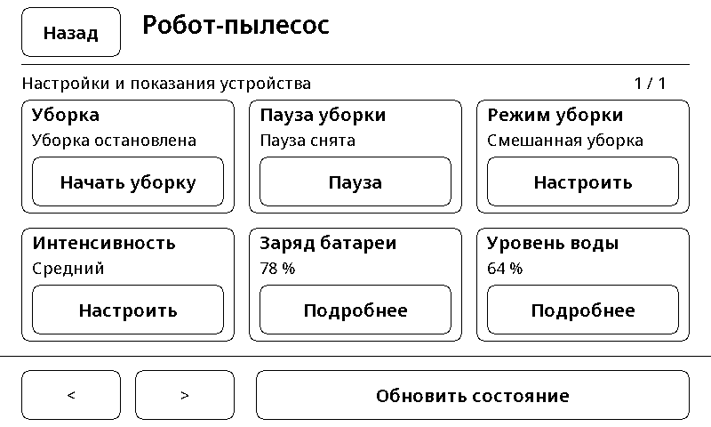

# Первый экран устройства и нажатия карточек — UI_PROFILES_V5

23.11.2026. Главная остаётся сеткой 3×2. Нажатие на название, состояние,
свободную часть карточки или шестерёнку открывает устройство. Внутренняя
кнопка действия имеет приоритет; отключённая кнопка поглощает касание.
Движение более чем на 16 пикселей отменяет нажатие даже внутри одной карточки.

## Как выбирается первый экран

Тип из API определяет **предпочтение интерфейса**, а не перечень разрешённых
функций. Выбирается первая подходящая функция, которую действительно объявил
провайдер. Если её нет, используется следующая доступная. Неизвестное состояние
не скрывает настройку. Остальные функции доступны через «Все функции».
Порядок объектов в JSON не определяет порядок элементов на экране.

Выбор приоритетов — наше UX-решение на основании документации и назначения
устройства; Яндекс не предписывает именно такую компоновку. Для робота,
стиральной машины, устройств для животных, датчиков и счётчиков с несколькими
функциями сначала показывается обзор действий/показаний. Если доступна всего
одна поддерживаемая функция, она открывается непосредственно.

| Устройства | Что показывается прежде всего | Следующие функции при наличии |
|---|---|---|
| Свет, все восемь подтипов | Яркость | Температура белого, HSV/RGB, эффекты, питание, подсветка |
| Термостат, кондиционер | Заданная температура | Режим климата, вентилятор, нагрев, питание, направление воздуха |
| Увлажнитель | Целевая влажность | Скорость, питание, ионизация и показания |
| Очиститель и вентиляция | Скорость вентиляции | Режим вентиляции, температура, питание и дополнительные функции |
| Вентилятор | Скорость | Питание, вращение, направление воздуха |
| ТВ, приставка, ресивер, медиа | Громкость | Канал, источник, питание, звук и пауза |
| Пылесос | Обзор: уборка, пауза, режим, интенсивность | Заряд и уровень воды, остальные объявленные функции |
| Шторы, окно, ворота, клапан | Степень открытия | Питание/привод, скорость и показания |
| Замок | Обзор только объявленных функций | Без выдуманного соответствия «питание = разблокировка» |
| Розетка, выключатель, реле | Включение/выключение | Подсветка, блокировка, измерения и другие функции |
| Чайник | Температура воды | Нагрев, вид чая, поддержание тепла, подсветка и блокировка |
| Кофемашина | Вид кофе | Программа, питание, другие параметры |
| Мультиварка | Программа | Температура, питание, поддержание тепла, блокировка |
| Кухонная техника, аэрогриль | Температура | Программа, нагрев, питание и остальные параметры |
| Посудомойка | Режим мойки | Программа, запуск/остановка, блокировка |
| Стиральная машина | Обзор: программа, работа машины, пауза | Температура и блокировка; если программ нет, работа машины идёт раньше паузы |
| Утюг | Температура | Программа и питание |
| Кормушка, поилка | Работа устройства и доступные режимы | Уровень корма/воды; размер порции не выдумывается |
| Датчик | Показания, соответствующие его подтипу | Остальные показания и доступные умения |
| Счётчик | Основной счётчик ресурса | Мощность, напряжение, ток и другие показания |
| Камера | Объявленные функции и показания | Видеопоток на E-Ink не воспроизводится |
| Другой/неизвестный тип | Общий обзор всех функций | Новые функции не отбрасываются из-за неизвестного типа |

Для датчиков подтип определяет первое показание: климат — температура и
влажность, газ — газ, движение — движение, освещённость — освещённость,
открытие — открытие, дым — дым, вибрация — вибрация, протечка — протечка,
кнопка — событие кнопки. У счётчиков холодной/горячей воды, газа, тепла и
электричества первым идёт соответствующий измеряемый ресурс.

## Пылесос и смысл команд

У робота `on_off` называется «Уборка», действия — «Начать уборку» и
«Остановить». `pause` называется «Пауза уборки»: включение паузы и продолжение
отправляют именно функцию `pause`, а не питание устройства. Снятая пауза не
объявляется доказательством того, что робот уже движется.

`cleanup_mode` — режим уборки; `work_speed` — интенсивность. Влажная, сухая и
смешанная уборка, экспресс и другие документированные режимы переведены.
Отдельная команда «На базу» не создаётся из голосовой фразы: в стандартном
наборе умений нет отдельного универсального `dock`. Поведение остановки
определяется провайдером. Кнопок карты, комнат уборки и зон без соответствующих
объявленных возможностей также нет.

Для чайника используются названия нагрева, кормушки — подачи корма,
стиральной/посудомоечной машины — работы устройства. Пауза, выключение звука
и блокировка кнопок получают свои подписи. `split` и отсутствие обратной связи
сохраняют различие между отдельными командами и одной кнопкой пульта.
Числовые размеры порций, длительности и программы производителя не угадываются.

Именованные режимы кофе, чая, готовки, вентиляции, мойки и уборки переведены
по опубликованным идентификаторам. Для `one`, `two` и подобных значений
сохраняются номера, а не выдуманные названия вроде «Хлопок». Неизвестное новое
значение остаётся доступным под исходным идентификатором.

Для `open` предустановки включают оба конца диапазона: 0%, 25%, 50%, 100%,
если границы/шаг устройства это разрешают. Значения ограничиваются реальными
параметрами, поэтому API не получает недопустимый ноль при минимуме выше нуля.

## Реализация и проверка

Правила находятся в `components/home_backend/include/DevicePresentation.hpp`.
UI получает профиль, исходную функцию, приоритет и подписи, но команды
формируются по прежним исходным `type/instance/value`. Сортировка отображения
не меняет порядок вариантов режимов и не ломает соответствие команды функции.

Фон карточки — резервное попадание после проверки всех явных кнопок. Отдельных
пересекающихся кнопок поверх карточки нет. Тесты проверяют приоритет действия,
поглощение отключённых кнопок, вход по названию/шестерёнке, отмену drag и возврат
на исходную страницу. Первый экран настроек не отправляет команду автоматически.

`python tools/check_home_capabilities.py` проверяет **все 54 типа** по матрице
`tests/fixtures/yandex-device-profiles.json`, отсутствие предпочтительной функции,
соответствие команд пылесоса и **355 экранов профилей**. Кроме этого проходят
357 состояний универсального управления и 1051 состояние прежних страниц.
Превью — `build/host-capabilities/profile-*.png`, данные на картинках тестовые.

Проверки backend, ArtManager, фото, тем и QR выполняются прежними инструментами.
Сборка — `idf.py -B build/art build`, маркер UART — `UI_PROFILES_V5`.
Новая версия автоматически на плату не записывается.

Все перечисленные проверки прошли. ESP-IDF 6.1 собрал образ `0x1401d0`
байт (1311184 байта); в разделе приложения осталось 37% свободного места.

## Источники

- [Все типы устройств Яндекса](https://yandex.ru/dev/dialogs/smart-home/doc/ru/concepts/device-types).
- [Свет](https://yandex.ru/dev/dialogs/smart-home/doc/ru/concepts/device-type-light),
  [термостат](https://yandex.ru/dev/dialogs/smart-home/doc/ru/concepts/device-type-thermostat),
  [пылесос](https://yandex.ru/dev/dialogs/smart-home/doc/ru/concepts/device-type-vacuum-cleaner).
- [Режимы и их функции](https://yandex.ru/dev/dialogs/smart-home/doc/ru/concepts/mode-instance),
  [список значений режимов](https://yandex.ru/dev/dialogs/smart-home/doc/ru/concepts/mode-instance-modes).
- [ТВ](https://yandex.ru/dev/dialogs/smart-home/doc/ru/concepts/device-type-media-tv),
  [шторы](https://yandex.ru/dev/dialogs/smart-home/doc/ru/concepts/device-type-openable-curtain),
  [вентиляция](https://yandex.ru/dev/dialogs/smart-home/doc/ru/concepts/device-type-ventilation).
- [Кофемашина](https://yandex.ru/dev/dialogs/smart-home/doc/ru/concepts/device-type-cooking-coffee-maker),
  [чайник](https://yandex.ru/dev/dialogs/smart-home/doc/ru/concepts/device-type-cooking-kettle),
  [мультиварка](https://yandex.ru/dev/dialogs/smart-home/doc/ru/concepts/device-type-cooking-multicooker),
  [посудомойка](https://yandex.ru/dev/dialogs/smart-home/doc/ru/concepts/device-type-dishwasher),
  [стиральная машина](https://yandex.ru/dev/dialogs/smart-home/doc/ru/concepts/device-type-washing-machine).
- [Кормушка](https://yandex.ru/dev/dialogs/smart-home/doc/ru/concepts/device-type-pet-feeder),
  [поилка](https://yandex.ru/dev/dialogs/smart-home/doc/ru/concepts/device-type-pet-drinking-fountain),
  [датчики](https://yandex.ru/dev/dialogs/smart-home/doc/ru/concepts/device-type-sensor),
  [счётчики](https://yandex.ru/dev/dialogs/smart-home/doc/ru/concepts/device-type-smart_meter).
- [Замок — бета](https://yandex.ru/dev/dialogs/smart-home/doc/ru/concepts/device-type-openable-door-lock),
  [аэрогриль — бета](https://yandex.ru/dev/dialogs/smart-home/doc/ru/concepts/device-type-cooking-grill-aero).
