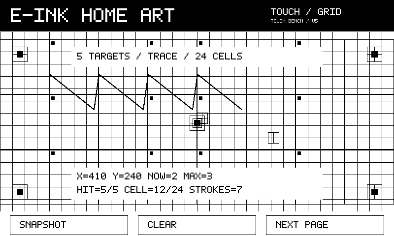

# Полноценный тест дисплея и тача — V5

Для GDEY075T7-T01 / UC8179, 800×480 и GT911. Запускаются дисплей, тач,
UART0 и heartbeat D6. Профиль сохраняет отключёнными PSRAM, ADC, LIS2DW12,
радиосвязь и управление зарядником. eFuse не меняются.

## Быстрый запуск

1. Прошить `build/E-InkHomeArt-display-touch.bin` с адреса **0x0**.
2. Сделать RESET без удержания BOOT. D6 мигает, появляется тестовая сетка.
3. В UART0, 115200 бод, дождаться `DISPLAY TOUCH TEST READY: V5` и
   `GT911 / 0x5D: READY`.
4. Касаться пяти мишеней, провести линии по сетке, проверить несколько пальцев.
5. Для немедленного отображения линий на компьютере открыть живой монитор ниже.
   Сам E-Ink в V5 обновляется частично: целевой интервал между началами
   обновлений — **350 мс**, фактическое время определяется BUSY и передачей.

Шлейфы подключаются только при полностью снятом питании. UART:
TX адаптера → J2.1/GPIO44, RX адаптера → J2.2/GPIO43, общий GND; уровни 3,3 В.
Питание платы отдельное. Для собранного прототипа с перемычкой вместо ETA6003
аккумулятор остаётся отключённым. Питание должно выдерживать импульсы обновления
панели; достаточность питания прошивка автоматически не подтверждает.

## Что проверять

- **Пять мишеней:** углы рабочей области и центр. После всех попаданий UART
  сообщает `TARGETS PASS: 5/5`, маска `targets=31` (`0x1f`). Мишени имеют допуск
  ±30 пикселей: это функциональный тест, а не метрологическая калибровка.
- **Покрытие:** провести пальцем по всем 24 ячейкам, восемь столбцов и три строки.
  Проверяемая область — X=0…799, Y=80…415. Полное покрытие:
  `COVERAGE PASS: 24/24 test-area cells`, маска `cells=16777215` (`0xffffff`).
  Крайние координаты вне этой области дополнительно видны в живом мониторе.
- **Линии:** одиночный палец оставляет след. На устройстве хранятся последние
  128 опорных точек с отсечением движений меньше трёх пикселей. После отпускания,
  смены track ID или мультитача линия начинается отдельно. На компьютере следы
  до пяти пальцев разделяются по ID; вывод UART ограничен примерно 10 отчётами
  движения в секунду, поэтому график показывает выбранные точки движения.
- **Мультитач:** приложить 2–5 пальцев. Видны число текущих контактов, максимум,
  ID, координаты и размер контакта. Значение SIZE — данные GT911, не сила нажатия.
  При слишком близких пальцах контроллер может объединять контакты.
- **Отпускание:** после снятия всех пальцев приходит свежий отчёт с count=0.
  Между отчётами состояние удерживается. Обычный опрос без свежих данных не
  создаёт ложных отпусканий и новых жестов.
- **Изображение:** страницы белого/чёрного заполнения, шахматной сетки и статуса
  с полосами 1/2/4 пикселя. Проверить глазами края, полосы, контраст и ориентацию.
  `EPD TX OK` подтверждает передачу и завершение BUSY, а не оптическое качество.
- **Жизнеспособность:** D6 мигает 500 мс / 500 мс независимо от обновления панели;
  тач и UART продолжают работать, пока отдельная задача ждёт BUSY или разрешённую паузу.

## Экранные кнопки и UART

На страницах сетки и статуса внизу три кнопки:
**SNAPSHOT**, **CLEAR**, **NEXT PAGE**. Действие выполняется один раз при отпускании
одного пальца внутри той же кнопки. Уход пальца с кнопки и мультитач отменяют
действие. NEXT PAGE на самой панели переключает только сетку и статус, поэтому
нельзя случайно попасть в белую заливку. На чистых заливках кнопок нет; вернуться
на сетку можно командой `g`. Пока новая страница ещё не показана, кнопки старой
страницы не исполняются. В UART видны `shown` (показано) и `requested` (запрошено).

| Команда UART + Enter | Действие |
| --- | --- |
| `r` | Запрос снимка текущего состояния |
| `f` | Принудительная полная очистка, даже без изменения изображения |
| `g` | Вернуться на сетку |
| `n` | Тестовые страницы через UART: сетка → белый → чёрный → шахматка → статус |
| `c` | Очистить след, попадания, покрытие, статистику жестов и ошибок |
| `t` | Следующая из восьми карт координат, очистка истории |
| `i` | Инверсия изображения |
| `a` | Включить/выключить автоматический запрос снимка после активности тача |
| `s` | Статистика в UART без запроса обновления E-Ink |
| `?` | Справка |

Короткое BOOT/S2 запрашивает снимок; удержание 1,5 с меняет инверсию.
При RESET удержанный BOOT по-прежнему включает загрузчик ESP32.
Команды принимаются только как отдельная односимвольная строка.

Автоснимок включён: снимок ставится в очередь через 40 мс после окончания
активности, а при непрерывном рисовании — не чаще раза в 100 мс. Очередь хранит
только самый новый снимок. Если байты изображения не изменились, обновление
пропускается.

**V5 — короткий интерактивный стендовый режим**, основанный на примере именно
GDEY075T7, а не непрерывный режим эксплуатации панели:

1. Первый кадр — обычный full refresh.
2. Тот же кадр дополнительно записывается в OLD RAM, включаются OTP partial
   и автоматическое копирование NEW → OLD (N2OCP).
3. Следующие кадры используют partial waveform. Вычисляется область
   отличий от показанного изображения, передаётся только её прямоугольник.
   X выравнивается по байтам; минимум 16×2 пикселя соблюдает строгие границы R90.
   Правый край X=799 и нижняя строка Y=479 включаются корректно. В источнике
   остаётся полный framebuffer со stride 100 байт, данные строк упаковываются драйвером.
4. В тестовом профиле лимит — **30 partial**. После его достижения экран ждёт
   отпускания пальцев и 1,2 с без активности, затем выполняет full clean даже
   без нового запроса снимка. До очистки дополнительные partial не выдаются;
   тач, UART и D6 продолжают работать. Очистка не начинается посреди известного
   задаче жеста; новый жест может начаться уже во время выполняющегося full.
   **30 — экспериментальный компромисс с остаточным следом**, а не рекомендация
   производителя: Good Display рекомендует пять. Настройка
   `DISPLAY_TOUCH_PARTIALS_BEFORE_CLEAN=5…100` по умолчанию в Kconfig равна 5;
   только этот тестовый профиль явно выбирает 30. При заметных следах выполнить
   `f` или уменьшить лимит. Запрос `f` сохраняется при замене ожидающих снимков.
5. Во время движения питание сохраняется на серии максимум из **пяти partial**.
   Между такими кадрами нет повторного POWER ON. После серии, full, кадра
   отпускания или примерно 200–260 мс без следующего обновления выполняется
   **POWER OFF 0x02**: высокие напряжения выключены, цифровые RAM/регистры
   сохранены. Следующий partial включает питание без RESET. Deep sleep между
   partial не вызывается: он уничтожает базу. Постоянного удержания питания нет.
6. После ошибки база считается недействительной, следующий кадр должен быть
   полным. Все ожидания BUSY ограничены тайм-аутом; heartbeat/тач/UART независимы.

Ускорение V5:

- SPI теста поднят с 1 до **8 МГц**. Полные 48 000 байт требуют теоретически
  48 мс вместо 384 мс, без учёта накладных расходов. В официальном примере
  производителя используется 10 МГц; базовая конфигурация платы для других
  приложений по-прежнему оставлена на 1 МГц.
- Убрана дополнительная секунда ПОСЛЕ завершения кадра. Ограничение 350 мс
  (`DISPLAY_TOUCH_TARGET_MS`, диапазон 300…2000) отсчитывается между НАЧАЛАМИ
  попыток. BUSY всё равно должен завершиться; параллельных обновлений нет.
- Контроллер ждёт готовности по BUSY. После DISPLAY REFRESH сохранён guard
  300 мкс (требуется не менее 200 мкс), после POWER ON/OFF — 1 мс; последующий
  опрос выполняется раз в RTOS tick. Задержки аппаратного RESET не сокращались.
- Передаётся только прямоугольник изменений. При изменении текста и следа
  одновременно он может быть большим: это одна общая ограничивающая область.
- Прямоугольники рисуются байтовыми полосами с масками краёв вместо обхода
  каждого пикселя; шахматная заливка тоже формируется по байтам. До смены
  надписи версии 360 примеров трёх рендереров совпали с V4 побайтово.
- На сетке числовые подписи фиксируются на время касания и обновляются при
  отпускании: их изменения не растягивают каждый dirty rectangle до низа экрана.
  UART, след, маркеры, покрытие и страница STATUS продолжают обновляться.
- Короткие серии partial убирают повторные включение/выключение питания из
  большинства кадров непрерывного рисования. На границах серий эти затраты остаются.

Заявленные производителем 0,3 с — время partial update при его условиях,
не гарантия 0,3 с от пальца до картинки. Полная очистка
по-прежнему мигает и занимает дольше. V5 не меняет LUT/напряжения для достижения
искусственно меньшего времени.

Для проверки скорости в UART добавлены реальные измерения:

```text
EPD PERF PARTIAL bytes=... render=...ms power=...ms spi=...ms busy=...ms off=...ms total=...ms
```

`busy` включает команду обновления, guard и ожидание BUSY; `total` — обновление
с подготовкой питания и power-off, без рендера и ожидания очереди. `render`
показан отдельно. Для FULL число байт также включает подготовку OLD RAM.
В V5 `power=0ms off=0ms` ожидается внутри активной серии. Отключение по
таймеру логируется отдельно как `EPD idle power off`; оно не входит в уже
выведенную строку PERF предыдущего кадра. Эти данные показаны и в живом мониторе.

Измеренные пользователем результаты V4 на изготовленной плате: partial BUSY
372–388 мс, SPI 7–21 мс, POWER ON 137–144 мс, OFF около 49 мс, render 99–101 мс;
цикл без render 568–601 мс. Full с подготовкой OLD RAM — 4108 мс. Эти замеры
объясняют приоритет коротких серий и редкой очистки; **результат V5 на плате
ещё не измерен**, время BUSY он искусственно не сокращает.
Если на 8 МГц появляются артефакты, установить
`DISPLAY_TOUCH_SPI_MHZ=4` или `1` и пересобрать: SPI не имеет обратного чтения
пикселей и может не сообщить об ошибке сигнала программно.

Для консервативного full-only режима отключить
`E-InkHomeArt → Interactive OTP partial-update bench test`
(`CONFIG_DISPLAY_TOUCH_PARTIAL_TEST=n`) и пересобрать. Тогда сохраняются старые
180 с между обновлениями и deep sleep после каждого кадра. Настройка
`DIAG_MIN_REFRESH_SECONDS=180…3600` относится к этому full-only режиму.
Команда `a` отключает автоснимки, оставляя ручное управление `r`/BOOT.

Счётчик STROKES считает группы касаний от первого нажатия до полного отпускания,
а FRAMES — свежие отчёты с ненулевым числом контактов. ERRORS считает ошибки
чтения; это не суммарное число дефектов устройства. Команда `c` начинает новую
сессию измерения. Ошибка чтения разрывает линию и отменяет экранную кнопку,
но не выдаёт вымышленное событие отпускания.

## Живое окно на компьютере

Страница [touch-live.html](touch-live.html) работает локально, без внешних библиотек
и передачи данных на сервер. Нужен Chrome или Edge с Web Serial.

Из корня проекта в обычном терминале:

```powershell
python -m http.server 8000 --bind 127.0.0.1 --directory docs
```

Открыть `http://127.0.0.1:8000/touch-live.html`, закрыть ESP-IDF Monitor или другую
программу, занявшую COM7, затем нажать **Подключить UART** и выбрать адаптер.
Включение порта выполняется самим пользователем. Питание платы берётся отдельно;
страница не меняет DTR/RTS и не запрашивает автоматический RESET.

Окно рисует касания физической панели в координатах 800×480, показывает пять
мишеней, 24 зоны, максимум контактов и ошибки чтения. Вверху доступно сохранение
JSON-отчёта: последнее состояние и до 10 000 последних отчётов UART. Кнопки
интерфейса отправляют те же односимвольные команды. Для новой проверки нажать
**Очистить**. Порт может использовать только одна программа одновременно.

Короткая строка прошивки для монитора:

```text
TOUCH2 count=2 map=0 targets=3 cells=255 strokes=2 max=2 points=1:100:150:12,2:400:280:10 raw=100,150
```

Каждая точка: `ID:X:Y:SIZE`, уже в координатах дисплея. Отпускание — `count=0`
и пустое поле `points=`. RAW показывает нативные координаты первой точки до
преобразования. `TEST_RESET map=N` сбрасывает историю браузера; `RESULT` содержит
статистику устройства. При исправлении монтажа после ошибки инициализации GT911
плату нужно перезапустить: повторное создание устройства автоматически не запускается.

## Сборка и запись

В активированном ESP-IDF 6.1, из корня проекта:

```powershell
idf.py -D SDKCONFIG=sdkconfig.display-touch -D "SDKCONFIG_DEFAULTS=sdkconfig.defaults;sdkconfig.defaults.display-touch" reconfigure build merge-bin -o E-InkHomeArt-display-touch.bin
```

После ручного входа BOOT/RESET, при освобождённом COM7:

```powershell
python -m esptool --chip esp32s3 -p COM7 -b 115200 --before no-reset --after no-reset write-flash 0x0 build/E-InkHomeArt-display-touch.bin
```

Затем отпустить BOOT, выполнить RESET. Текущий `build/` содержит именно профиль
Display/Touch; отдельный корневой `sdkconfig` может по-прежнему описывать LED-тест.
Чтобы не получить старый LED-образ, использовать указанную явную команду сборки.

## С чем сверено

- [Good Display GDEY075T7-T01](https://www.good-display.com/product/483.html):
  UC8179, 800×480, GT911 с поддержкой пяти точек, SPI и I²C.
- [Спецификация панели](https://www.good-display.com/companyfile/1167.html) и
  [официальный пример](https://www.good-display.com/companyfile/1838.html).
  Normal/full последовательность сохранена; partial добавлен отдельным API.
- [Good Display FAQ, пункт 24](https://www.good-display.com/news/238.html):
  сон/выключение после обновления и интервал SPI-панелей не менее 180 с.
  Указанные на странице изделия 0,3 с относятся к отдельному режиму partial;
  это не разрешение вызывать full-refresh каждые 0,3 с. Для короткого стендового
  профиля использован отдельный модельный partial-пример ниже.
- [Good Display ESP32epdx, GDEY075T7 EPD.cpp](https://github.com/gooddisplayshare/ESP32epdx/blob/d5ed3b777bedb9b407ccff09dc810a9248eb7926/examples/2-Colors%20(BW)/7.5/GDEY075T7/EPD.cpp)
  и соседний `GDEY075T7.ino`, commit `d5ed3b777bedb9b407ccff09dc810a9248eb7926`:
  OTP partial `E0=02`, `E5=6E`, `50=A9,07`, `91/90/13/12/92`, периодическая
  рекомендация полной очистки после пяти partial. Пример `.ino` выполняет
  несколько partial подряд до DeepSleep; V5 ограничивает серию пятью.
  Экспериментальный лимит очистки 30 выбран в нашем тестовом профиле отдельно.
  В драйвере это самостоятельная реализация
  ESP-IDF; код Arduino и изображения производителя в репозиторий не включены.
- [UltraChip UC8179 rev0.6](https://files.seeedstudio.com/wiki/Other_Display/750-epaper/IC%20Driver%20UC8179.pdf):
  R02 — сохранение регистров при power-off, R50 — N2OCP, R90…R92 — границы
  partial-окна, R07 — deep sleep. OLD RAM заполняется явно после full;
  состояние partial не сохраняется через аппаратный сброс или deep sleep.
- [Официальный драйвер Espressif GT911](https://github.com/espressif/esp-bsp/tree/master/components/lcd_touch/esp_lcd_touch_gt911),
  локально зафиксированная версия 1.2.1: регистр `0x814E`, ready в bit7,
  число точек в bits0…3, до пяти записей по восемь байт, очистка статуса после чтения.
  Добавлен совместимый API `gt911_read_frame(..., &fresh)`; старый `gt911_read()` сохранён.
  [Описание этой ошибки в трекере Espressif](https://github.com/espressif/esp-bsp/issues/501)
  отдельно объясняет отличие отсутствия готовых координат от отпускания.
- [ESP-IDF 6.1 I²C](https://docs.espressif.com/projects/esp-idf/en/v6.1/esp32s3/api-reference/peripherals/i2c.html):
  конечные тайм-ауты; последовательные операции с GT911 выполняются одной задачей.
- [Chrome Web Serial](https://developer.chrome.com/docs/capabilities/serial):
  выбор порта по нажатию пользователя, асинхронные потоки, освобождение reader/writer
  перед закрытием порта. Поток разбирается с сохранением незаконченных строк.

## Программная проверка

```powershell
python tools/check_drivers.py
node tools/check_touch_monitor.js
```

Проверяются реальные C-драйверы, различие ready/no-report/release, пять точек,
ошибки I²C, подготовка OLD RAM и OTP partial, границы окна до X=799/Y=479,
POF/wake, восстановление после ошибки, покрытие, разрывы и кольцевой буфер следа, границы координат,
защита framebuffer, инверсия и тестовые заливки. Проверка браузерного кода
использует его реальный обработчик UART, включая фрагментированные строки,
смену track ID, отпускание, сброс и ошибочные координаты; настоящий COM-порт
при этом не открывается. Демонстрационное превью C-рендерера:



Сборка и имитация не подтверждают пайку, реальные касания или изображение панели:
эту часть проверки выполняем после записи прошивки на устройство.
