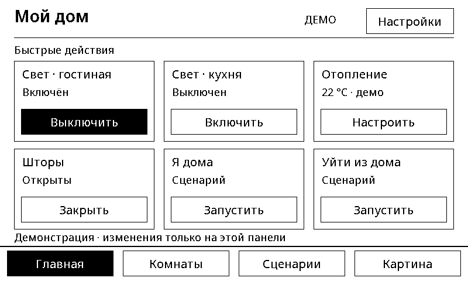
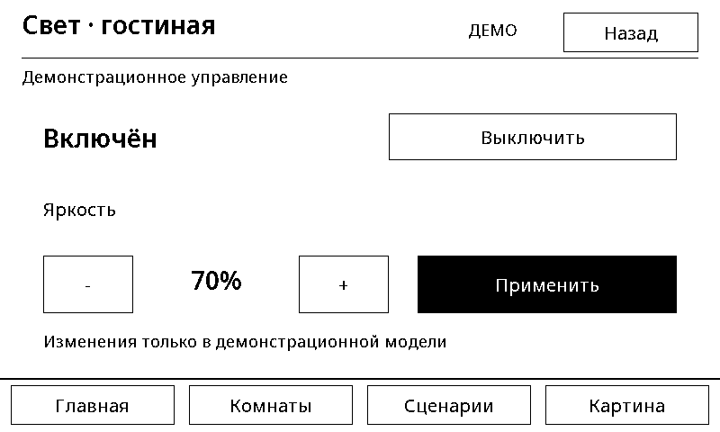

# Сенсорный интерфейс A: первоначальная демонстрация

Этот документ описывает сохранённую демо-модель и её проверки. Основной
профиль теперь использует [реальный Яндекс Дом](YANDEX_HOME.md).

20.11.2026 пользователь выбрал **A: быстрые действия** и возврат к картине
через **45 секунд**. Реализация входит в основной профиль `build/art`.



## Что работает

- В Art Mode первое касание открывает главный экран и целиком поглощается
  до отпускания пальца. Оно не переключает устройство под местом касания.
- На главной шесть действий: свет гостиной, свет кухни, отопление, шторы,
  сценарии «Я дома» и «Уйти из дома». Касание заголовка карточки открывает
  экран устройства; нижняя кнопка выполняет демонстрационное действие.
- Внизу — «Главная», «Комнаты», «Сценарии», «Картина». Есть настройки,
  комнаты с устройствами и возврат назад.
- Экран устройства: включение, шаговые кнопки яркости/температуры/открытия
  штор и отдельное «Применить». Черновое значение не применяется до кнопки.
- После 45 секунд бездействия возвращается сохранённая фотография в четырёх
  градациях. Тайм-аут отсчитывается от фактического показа страницы/активности,
  а не от начала медленного первого refresh. Палец на экране откладывает возврат.
- «Картина» возвращает фотографию сразу. Новая загрузка через браузер тоже
  закрывает меню и показывает новое фото, без трёхминутной паузы.
- Если сохранённой картины нет, показывается инструкция загрузки.

**Это демонстрационная модель:** состояния комнат/света/температуры придуманы,
помечены «ДЕМО», меняются только в RAM и сбрасываются после перезагрузки.
Реальные устройства и Яндекс пока не подключены. Заряд батареи, время и
Интернет не изображаются выдуманными достоверными показаниями.



## Проверка на плате

```powershell
idf.py -B build/art build
idf.py -B build/art -p COM6 flash monitor
```

Сохраняется та же разметка и тот же art-раздел. Полное `erase-flash` не нужно.
20.11.2026 подтверждён тот же ESP32-S3 на COM6; этот порт выбран и в VS Code.
Загрузчик на этой сборке платы может требовать ручного BOOT+RESET; UART-монитор
перед прошивкой надо закрыть. После запуска искать `ART UI READY`.

1. С фотографией на экране коснуться будущего места кнопки: откроется меню,
   действие не выполнится. Отпустить и нажать кнопку ещё раз — изменится демо.
2. Открыть комнаты, сценарии, экран устройства; проверить «Применить» и «Назад».
3. Подержать/протащить палец, использовать два пальца: случайной команды нет.
4. Ничего не трогать 45 секунд — должна вернуться **та же** фотография.
5. Во время меню загрузить новое фото; затем снова открыть меню и вернуться
   к картине. При обрыве передачи предыдущий сохранённый кадр остаётся целым.
6. Проверить значения `heap/largest` и строки `UI FULL`, `UI PARTIAL`,
   `DISPLAY mode=... time=...` в UART. Фактический отклик и ghosting измеряются
   на панели; программные тесты не подтверждают их автоматически.

UART: `h` — главное меню, `a` — картина, `?` — сведения подключения,
`t` — следующий из восьми вариантов ориентации тача (по умолчанию 0).
Ориентация пока меняется только до перезагрузки; GT911 не перепрошивается.

## Обновления, ввод и память

Фото использует OTP gray4; меню — монохромный OTP full/partial UC8179.
Вход в меню требует первого полного монохромного кадра и заполнения OLD RAM.
Дальше передаётся прямоугольник изменений, после каждого обновления высокие
напряжения выключаются через POF с сохранением RAM контроллера. Сохранён уже
использовавшийся на прототипе лимит **30 partial**: следующее изменение делает
полный очистительный refresh. Это экспериментальная политика V6; рекомендация
производителя — пять, накопление ghosting требует проверки на UI. В простое
дополнительные очистки не запускаются. Возврат к фото делает gray4 init/full/sleep.

Все вызовы панели выполняет одна задача ArtManager. Основная задача продолжает
опрашивать touch/UART; D6 работает от своего таймера. Нажатия исполняются на
отпускании, только для уже показанной ревизии UI. Пока экран меняется, жесты
поглощаются, что исключает нажатие кнопки новой страницы по старой картинке.

Сохранился один буфер **96064 байта**, PSRAM выключена. В Art Mode это пакет
фотографии; в UI он разделён на рабочие 48000 байт и базу предыдущего кадра
48000 байт. Фотография остаётся во Flash и читается обратно при возврате.
Каждый приём HTTP инвалидирует монохромную базу: если передача оборвалась,
меню перерисовывается полностью перед следующим partial. Нового полного
framebuffer во время загрузки не выделяется.

Кириллица — заранее подготовленные монохромные глифы Noto Sans под открытой
SIL OFL 1.1, лицензия и источник в `components/home_ui/vendor/`.
Сборка прошивки не скачивает шрифты и не требует Pillow.

## Локальные данные для следующего этапа

- `secrets/yandex.json` — OAuth Client ID/secret, поля access/refresh token.
- `secrets/wifi.json` — имя домашней сети и пароль.

Папка `/secrets/` игнорируется Git. Значения не печатаются в лог сборки и не
встраиваются этим UI в образ. Основная прошивка пока создаёт прежнюю открытую
точку доступа; чтение домашних настроек и авторизация Яндекса — следующий этап.
Скриншоты/документация не содержат значений из этих файлов.

## Программные проверки

```powershell
python tools/check_home_ui.py
python tools/check_art_http.py
node tools/check_art_client.js
node tools/check_art_upload.js
```

`check_home_ui.py` запускает реальные модель и renderer C: поглощение первого
жеста, показанная ревизия, отпускание/drag/мультитач, навигация, Apply,
граница 45 секунд, удержание, шрифт/границы всех страниц и крайние пиксели.
PNG в `build/host-ui` получены из настоящих framebuffer, не из HTML/SVG.
Тест менеджера исполняет переходы Art/full/partial/возврат того же кадра,
восстановление базы после прерванной передачи и загрузку фото из меню.
Границы SDK/RTOS/Flash/панели имитируются; это не аппаратное испытание.

20.11.2026 проверки UI, HTTP/ArtManager, клиентского кодека и 20 сценариев
драйверов прошли; ESP-IDF 6.1 собрал образ 946608 байт. UI записан на ту же
ESP32-S3 через COM6 после ручного BOOT+RESET, esptool подтвердил хеш.
Загрузчик и таблица уже совпадали и были пропущены, art-раздел не записывался.
Физическая проверка касаний, скорости и возврата к картине ещё предстоит.
