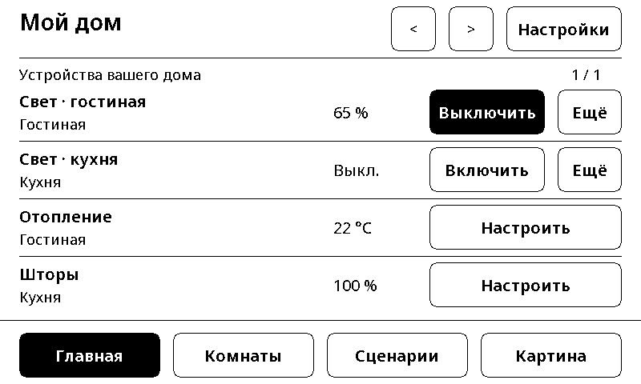
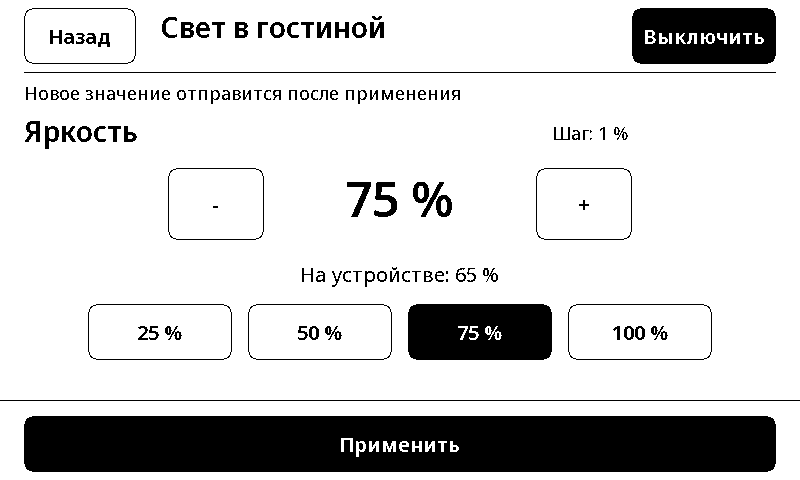

# Сенсорный интерфейс «Список», Revision 2

22.11.2026 пользователь выбрал **«Список»** из трёх предложений
[Revision 2](../design/ui-rev2/README.md). Реализация — в основном профиле
`build/art`. Изображения ниже получены настоящим C-рендерером прошивки;
данные демонстрационные, без личных устройств и токенов.



## Компоновка и управление

- На странице четыре строки устройств, комнат или сценариев. Главная
  показывает устройства, сценарии вынесены в свою вкладку. Стрелки меняют
  страницу по четыре записи, номер страницы виден справа под шапкой.
- Имя и комната слева, подтверждённое состояние в отдельной колонке,
  действие справа. «Ещё» открывает устройство. Для устройства без переключателя
  питания есть одна широкая кнопка «Настроить» / «Подробнее».
- Фон строки и подписи не нажимаются. Минимальная цель — 56×56 пикселей,
  соседние кнопки разделены минимум 16 пикселями. Общая геометрия находится
  в `components/home_ui/home_ui_layout.h` и используется рисованием и touch.
- Длинные подписи обрезаются по реальным ширинам глифов, без изменения высоты
  строки. Заголовок устройства при необходимости занимает две фиксированные
  строки. Неподдерживаемые символы заменяются на `?`.
- В карточке устройства — одна кнопка питания в шапке, выбранное значение,
  отдельное фактическое значение, минус/плюс и четыре предустановки.
  Команда диапазона отправляется только большой кнопкой «Применить» внизу.
  На этом экране нижние вкладки заменены кнопкой применения; «Назад»
  возвращает к прежней странице и её позиции.
- Возможности определяются каталогом: выключатель, регулятор, оба вместе
  либо просмотр показаний. Несуществующие действия не рисуются.



## Сеть и результат команды

Пока backend занят, управляющие команды недоступны, геометрия не меняется.
Без сети показаны последние значения; можно просматривать устройства,
но отправка команд отключена. Изменение состояния не изображается успешным
до ответа/readback backend.

Неподтверждённый POST помечается явными полями `command_failed` и
`failed_device` в модели, без разбора текста ошибки. Для этого устройства
появляется «Проверить состояние»; на главной — «Проверить». Это **GET каталога**,
а не повтор команды. Проверка доступна при работающей сети/часах, даже если
предыдущая загрузка каталога не удалась или устройство стало недоступным.
Успешная явная проверка снимает отметку. Команды автоматически не повторяются.

Тема переключается в настройках; QR на странице ожидания входа остаётся
чёрным на белом в обеих темах. Сохраняются загрузка/хранение фотографии,
45-секундный возврат к ней и поглощение первого касания при пробуждении меню.

## Программные проверки

```powershell
python tools/check_home_ui.py
python tools/check_home_backend.py
python tools/check_art_http.py
python tools/check_login_qr.py
idf.py -B build/art build
```

`check_home_ui.py` проверяет **1056 реальных C-кадров**: попарное пересечение
всех кнопок, текстовых областей и текста с чужими кнопками, границы кадра,
размер целей, offline/pending/ошибки, длинные имена, обе темы, предельные
страницы каталога и варианты возможностей устройства. Измерения текста
берутся из используемых bitmap-шрифтов. Контрольная обвязка компилируется
только в host-проверку, в прошивку не входит. Превью — `build/host-ui`.

Отдельно проверяются навигация, реальные индексы устройств, черновик/применение,
неактивность до показа новой ревизии, мультитач/drag, возврат к той же картине,
обработка неизвестного результата POST и последующий GET без повторного POST.
Независимый ZXing читает QR из байтов, предназначенных для SPI.

Все перечисленные проверки прошли. ESP-IDF 6.1 собрал основной образ
размером `0x153230` байт; в разделе приложения осталось 34% свободного места.

## Проверка на устройстве

Образ собирается в `build/art/E-InkHomeArt.bin`. Маркер в UART:
`ART UI READY / UI_LIST_V2 QR1 THEMES1`. Эта версия автоматически не записывается
на плату: прошивку пользователь ранее отложил.

После записи проверить главную/следующую страницу/комнаты/сценарии, возврат
из устройства на прежнюю страницу, единичное применение регулятора, тему и QR,
переход к картине через 45 секунд. Геометрические проверки не устанавливают
причину ранее замеченных наложений на физическом E-Ink: остатки прошлого кадра
и качество partial/full нужно оценить на панели. Политика обновлений драйвера
в этой работе не изменялась.
