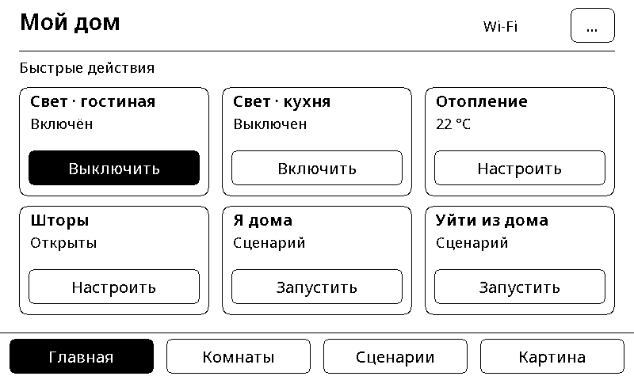
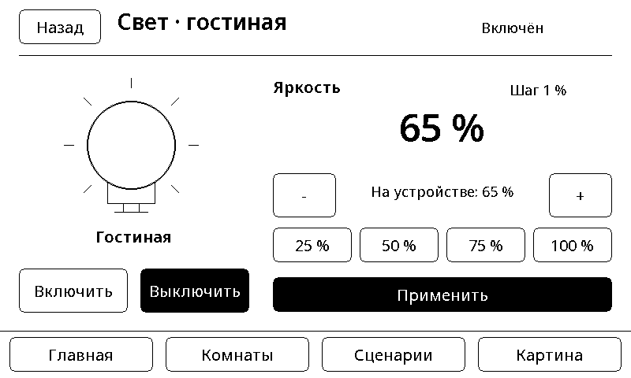
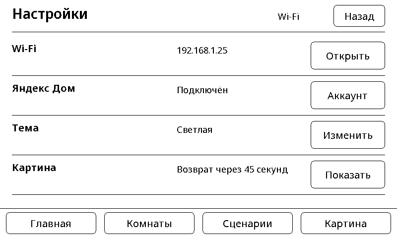

# Интерфейс по первоначальному макету A

22.11.2026 пользователь попросил приблизить прошивку к первоначальным рендерам.
Основа — [главная A](../design/ui-rev1/renders/01-home-a.png),
[экран устройства](../design/ui-rev1/renders/05-device.png) и
[настройки](../design/ui-rev1/renders/08-settings.png).
Это реализация в C framebuffer основного профиля `build/art`, а не новый
отдельный HTML-макет.

## Главная



- Шесть округлённых карточек в сетке 3×2, крупные названия, состояния и
  центрированные кнопки. Активное действие выделяется чёрной заливкой.
- На первой странице — до четырёх реальных устройств и двух реальных сценариев.
  Если сценариев или устройств меньше, место занимает следующий доступный элемент.
  Остальные устройства/сценарии доступны через страницы; ничего не пропадает
  из каталога. Для всех карточек сохраняется исходный индекс и ревизия каталога.
- Округлённая нижняя навигация: «Главная», «Комнаты», «Сценарии», «Картина».
  Кнопка `...` вверху открывает настройки. Страницы переключаются стрелками
  над карточками; кнопки не перекрывают нижний ряд.
- Нет фиктивного заряда или времени обновления: показывается реальный статус
  сети и ответы backend. При отсутствии связи сохранённые карточки видны,
  кнопки подписаны «Нет связи» и не отправляют команд. Ожидание/ошибки
  команды выводятся без непрерывной анимации.

## Устройство



- Название и состояние в шапке, большая контурная иконка, название комнаты,
  отдельные кнопки «Включить» и «Выключить» с явным целевым состоянием.
  Иконка выбирается по типу реального устройства: свет, отопление, шторы,
  остальные — значок питания.
- Числовой регулятор: крупное значение, текущая величина на устройстве,
  шаговые `−`/`+`, четыре предустановки и отдельное «Применить».
- Единицы берутся из API: проценты, °C, K. Неизвестная единица не угадывается.
  Шаг и диапазон остаются заданными API. Предустановки округляются к допустимому
  шагу и не выходят за границы. Нажатие предустановки меняет только черновик;
  сеть вызывается после «Применить».
- Устройства без регулятора не получают выдуманные кнопки яркости.
  Показания и поддерживаемые действия остаются доступны.
- Возврат из устройства сохраняет страницу списка, с которой оно открыто.

## Настройки и вход



Настройки оформлены строками, как в исходном рендере: сеть, Яндекс Дом,
тема, картина. Страница сети показывает адреса для загрузки фотографии;
кнопка «Аккаунт» открывает отдельную страницу входа/выхода/обновления устройств.
Путь к QR: **`...` → Аккаунт → Войти в Яндекс**.
Переключение темы и её сохранение, белое поле QR в тёмной теме, сохранённая
авторизация и возврат к картине через 45 секунд остаются действующими.

Рендеры используют тестовые данные для воспроизводимости. На панели названия,
комнаты, сценарии, состояния и диапазоны берутся из настоящего аккаунта.

## Проверки и запись

```powershell
python tools/check_home_ui.py
python tools/check_art_http.py
python tools/check_home_backend.py
python tools/check_login_qr.py
```

Проверены маршрутизация смешанных карточек и страниц, размеры кнопок и попадания,
отсутствие команд при выборе предустановки, Apply, возврат на прежнюю страницу,
отключённые кнопки, обработка ответов Яндекса, Art/partial/Art и QR в двух темах.
Новые шрифты добавлены из того же закреплённого OFL-источника Noto Sans:
20 px semibold и 48 px для чисел/единиц. Сетевые endpoint, алгоритмы обновления
дисплея и разметка Flash не менялись.

Аппаратная проверка нового оформления остаётся после прошивки. Запись на плату
ранее отложена пользователем; эта работа не выполняет её автоматически.
