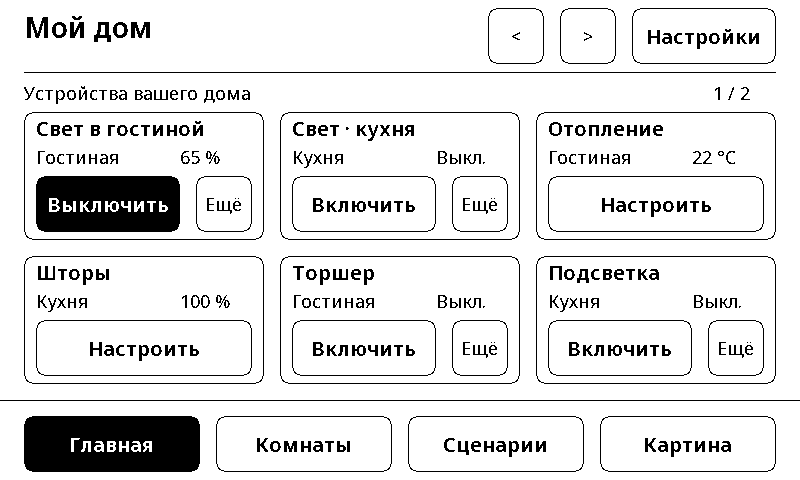

# Плиточный интерфейс, Revision 3

Актуальные нажатия карточек и первые экраны устройств описаны в
[UI_PROFILES_V5](DEVICE_PROFILES.md); ниже сохранена история Revision 3.

23.11.2026 пользователь попросил заменить список плиткой в том же стиле,
чтобы на экран помещалось больше устройств. На главной, в комнате, в списке
комнат и сценариев теперь **шесть плиток, сетка 3×2**, вместо четырёх строк.

## Геометрия и действия

- Каждая плитка — 240×128 пикселей; между плитками 16 пикселей.
  Шапка и нижняя навигация сохраняют прежние позиции.
- Вверху имя, ниже комната и фактическое состояние. Длинные подписи
  сокращаются по ширине bitmap-глифов, не изменяя геометрию.
- Внизу плитки переключателя — действие 144×56 и «Ещё» 56×56,
  разделённые 16 пикселями. «Ещё» набрано шрифтом 18 px, чтобы помещалось
  целиком. Плитка и её подписи сами не нажимаются.
- Для регулятора без переключателя питания используется одна кнопка
  «Настроить» 216×56; для показаний — «Подробнее». Комнаты и сценарии
  используют такую же широкую кнопку открытия/запуска.
- Пагинация идёт по шесть элементов, с сохранением реальных индексов;
  «Назад» из устройства возвращает на прежнюю страницу.

Экран регулятора, темы, QR, ожидание команд, проверка состояния после ошибки,
45-секундный возврат к картине и сохранение фотографии остаются такими,
как в [Revision 2](UI_LIST_V2.md).

## Проверки

`python tools/check_home_ui.py`: **1051 состояние реального C-рендерера**,
включая обе темы, длинные названия, offline/pending/ошибки, предельные страницы
каталога и варианты возможностей устройства. Нет пересечений кнопок/текста,
выхода за кадр и целей меньше 56×56. Проверены касания шестой плитки,
переход на вторую страницу, применение к правильному устройству и возврат.
Превью с демонстрационными данными — `build/host-ui/rev3-*.png`.

`python tools/check_art_http.py` проверяет реальные переходы менеджера
Art ↔ плитки, pending/подтверждение команд, partial/full и возврат той же
фотографии. Это host-проверки; физическое качество E-Ink проверяется на плате.

Основной образ — `build/art/E-InkHomeArt.bin`, сборка `idf.py -B build/art build`.
Все перечисленные проверки и сборка ESP-IDF 6.1 прошли. Размер образа —
`0x1533a0` байт, в разделе приложения осталось 34% свободного места.
Маркер UART: `ART UI READY / UI_TILES_V3 QR1 THEMES1`.
Автоматическая прошивка платы не выполнялась.
