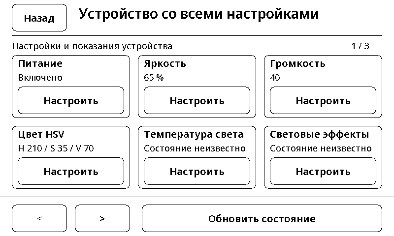
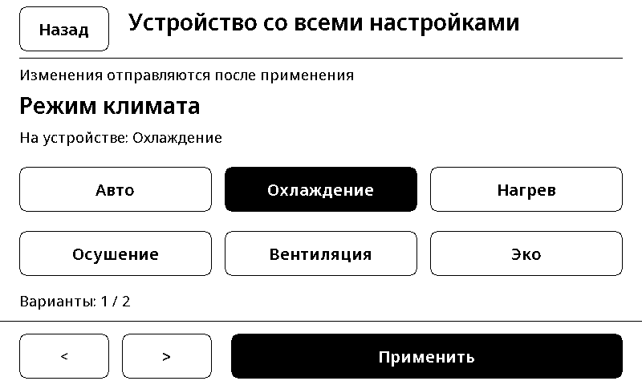
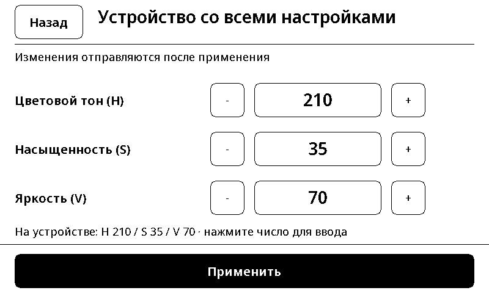

# Все настройки устройств из API Яндекса

23.11.2026 пользователь попросил расширить управление устройствами,
сохранив плиточный стиль. Раньше модель UI содержала только питание и первый
числовой регулятор с известным состоянием. Остальные умения терялись при
преобразовании каталога. Теперь у каждого устройства есть весь набор
экспортированных умений и показаний с отдельными экранами управления.



Данные на иллюстрациях синтетические: это проверочная модель, объявляющая
разные возможности. Настоящая панель показывает только то, что вернул Яндекс
для конкретного устройства; функции не подбираются по названию или типу.

## Проверенная документация

Используется пользовательский API `api.iot.yandex.net`, а не URL провайдера:

- [Получение полного каталога](https://yandex.ru/dev/dialogs/smart-home/doc/ru/concepts/platform-user-info):
  `GET /v1.0/user/info`, `capabilities`, `parameters`, `state`, `properties`.
- [Управление умениями](https://yandex.ru/dev/dialogs/smart-home/doc/ru/concepts/platform-capabilities):
  `POST /v1.0/devices/actions`, конкретные тип/функция/значение, результат `DONE`/`ERROR`.
- [Типы умений](https://yandex.ru/dev/dialogs/smart-home/doc/ru/concepts/capability-types),
  [on_off](https://yandex.ru/dev/dialogs/smart-home/doc/ru/concepts/on_off),
  [toggle](https://yandex.ru/dev/dialogs/smart-home/doc/ru/concepts/toggle),
  [mode](https://yandex.ru/dev/dialogs/smart-home/doc/ru/concepts/mode),
  [range](https://yandex.ru/dev/dialogs/smart-home/doc/ru/concepts/range),
  [функции range](https://yandex.ru/dev/dialogs/smart-home/doc/ru/concepts/range-instance),
  [color_setting](https://yandex.ru/dev/dialogs/smart-home/doc/ru/concepts/color_setting).
- [Числовые показания](https://yandex.ru/dev/dialogs/smart-home/doc/ru/concepts/float-instance)
  и [события датчиков](https://yandex.ru/dev/dialogs/smart-home/doc/ru/concepts/event-instance)
  показываются как данные для чтения.
- [Video_stream](https://yandex.ru/dev/dialogs/smart-home/doc/ru/concepts/video_stream)
  описывает HLS-видео. Воспроизведение видео на E-Ink не реализовано; такое
  умение показывается с пояснением. Другие неизвестные типы также не скрываются
  и не превращаются в произвольную команду.

## Что доступно на панели

| Возможность API | Управление |
|---|---|
| `on_off` | Выбор включения/выключения и применение; при ИК-питании без обратной связи и `split:false` — одна кнопка команды питания |
| `toggle` | Все дополнительные переключатели: пауза, звук, блокировка, подсветка и другие объявленные функции |
| `range` | Все диапазоны; минус/плюс, прямой ввод, предустановки при известных границах, шаг и единицы из API |
| Относительный `range` | Изменение со знаком и `relative:true`; неизвестное итоговое значение не выдумывается |
| `mode` | Все объявленные варианты с перелистыванием; выбор отдельно от отправки |
| RGB | Каналы R/G/B от 0 до 255, прямой ввод, отправка единого 24-битного значения |
| HSV | Тон 0…360, насыщенность/яркость 0…100, отправка одного объекта `{h,s,v}` |
| Температура белого | Самостоятельный регулятор в кельвинах по границам из API, даже когда сейчас активен цвет |
| Световые эффекты | Выбор только из объявленных `color_scene.scenes`, с правильным исходным ID |
| Float / Event | Все экспортированные показания и события; без кнопки отправки команды |

Настройки открываются через «Ещё»/«Настроить» на главной. Внутри — шесть
плиток на страницу: питание, диапазоны, режимы, цвет, эффекты, показания.
«Назад» из конкретной настройки возвращает к той же странице умений,
а из устройства — к прежней странице основного каталога.



## Числа, цвет и неизвестное состояние

Нажатие на число открывает клавиатуру. Есть очистка, удаление, знак и дробная
часть. Внизу указаны допустимые границы и шаг. Некорректный ввод не закрывает
экран и не создаёт команду. Парсер цифрового ввода не выделяет память.

В цветном регуляторе числовые каналы заменяют цветовую палитру: это позволяет
выбрать любой поддерживаемый RGB/HSV на монохромном экране. Внизу показано
последнее полученное состояние, выбранные значения отправляются вместе.



Если `state:null`, неактивна другая функция цвета или `retrievable:false`,
настройка больше не пропадает. Её состояние подписано как неизвестное.
У переключателя без известного состояния сначала нужно выбрать действие:
ложное значение «выключено» не выделяется автоматически. `split` отличает
раздельные команды питания от единственной ИК-команды.

Для `range` разрешены отсутствующие границы, `precision` по умолчанию 1,
`random_access` по умолчанию true. Произвольные числовые пределы не выдаются
за параметры устройства. Предустановки есть только при известных границах;
относительное управление не требует знания текущего состояния.

## Передача команд и ограничения ресурсов

UI передаёт индексы устройства/умения/варианта с версией каталога. Backend
сопоставляет их с исходными `type`, `instance` и значениями, проверяет границы,
шаг, тип данных, разрешённый режим, принадлежность устройству и доступность.
Переведённые или сокращённые подписи никогда не используются как ID команды.
Изменение состава умений или вариантов меняет версию каталога и отменяет
устаревший экран. Новые числовые состояния эту версию не меняют.

Прежние правила ожидания, offline, проверки после неподтверждённой команды
и отсутствия автоматического повторения POST сохранены. Фото, Flash-разделы,
тайминги панели, темы, QR входа и возврат через 45 секунд не изменялись.

Модель ограничена **32 устройствами, 384 умениями/показаниями и 1024 вариантами**
на каталог. Переполнение отмечается в данных и видимой строке состояния.
Это предел памяти текущей реализации, а не лимит Яндекса. Размер снимка модели
на host — 166224 байта; основной профиль с включённой PSRAM хранит модели
в выделенных буферах, без размещения полного каталога на стеке задачи.

## Проверки и запуск

```powershell
python tools/check_home_capabilities.py
python tools/check_home_backend.py
python tools/check_home_ui.py
python tools/check_art_http.py
python tools/check_login_qr.py
idf.py -B build/art build
```

Новая проверка использует реальные C++ parser/catalog/action и C touch/renderer:
**JSON API → плитка настройки → выбор/ввод → валидированный JSON POST**.
Проверены все пять типов умений, RGB/HSV, отдельная температура белого,
эффекты, относительные команды без границ, дробный шаг, неизвестные состояния,
ИК-питание, свойства, запрет чужого/устаревшего индекса, переполнение пулов.
**357 новых экранных состояний** проверены на пересечение текста/кнопок,
размеры целей и границы framebuffer; ещё **1051** — регрессия основных страниц.
Иллюстрации получены из framebuffer этой же прошивки.

Маркер новой версии: `ART UI READY / UI_CAPS_V4 QR1 THEMES1`.
Все перечисленные проверки прошли. ESP-IDF 6.1 собрал образ размером
`0x13b910` байт (1292560 байт); в разделе приложения осталось 38% свободного места.
Образ — `build/art/E-InkHomeArt.bin`. Запись на плату и приёмка реальных
действий каждого устройства остаются отдельным шагом; автоматически не прошиваем.
