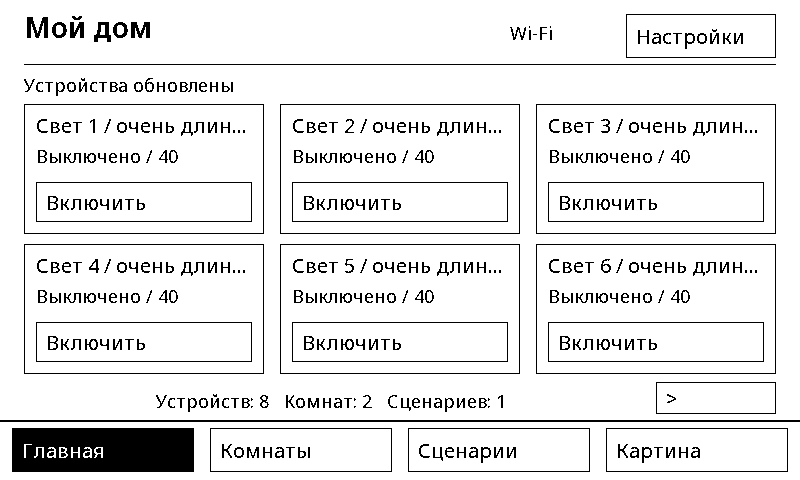
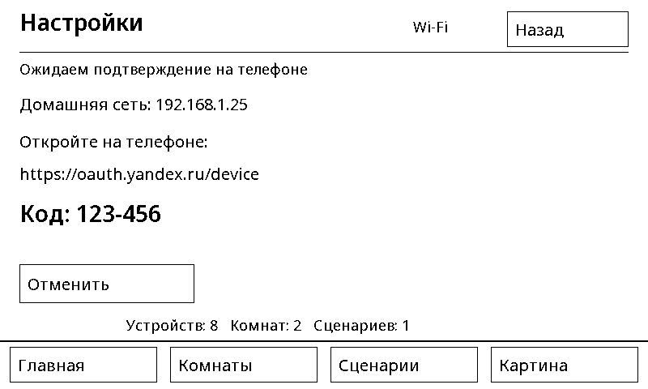

# Домашний Wi-Fi и Яндекс Дом

20.11.2026. Основной профиль `build/art` теперь использует живую модель Яндекса.
Сборка и тесты выполнены; образ записан на плату через COM7 с проверкой хеша.
На плате подтверждены домашний Wi-Fi, PSRAM, восстановление картины,
сенсорный UI, вход в Яндекс, загрузка настоящего каталога, подтверждённая
команда и восстановление входа после RESET.



## Настройки локальной сборки

`secrets/wifi.json` содержит `ssid` и `password`; `secrets/yandex.json` —
`client_id` и `client_secret` приложения с правами `iot:view` и `iot:control`.
Существующие локальные файлы используются без переноса в Git.
Образцы без настоящих значений: [Wi-Fi](../config/wifi.example.json),
[OAuth](../config/yandex.example.json). Скопировать их в `secrets/` и заполнить.
Без файлов проект собирается: остаётся открытая точка доступа для фотографии,
а при попытке входа появляется указание заполнить OAuth-настройки.

CMake создаёт `build/art/private/home_private.h`; изменения JSON вызывают
повторную конфигурацию. Пароль Wi-Fi и секрет OAuth входят в локальный
бинарный образ. Такой образ содержит персональные настройки; для публикации
собирать без личных файлов. Пароль и секрет не печатаются в UART и не отдаются HTTP.
Поля `access_token`/`refresh_token` из JSON не встраиваются в прошивку:
рабочая сессия получается через OAuth и хранится в NVS.

## Первый запуск

1. Собрать и прошить **включая таблицу разделов**, без `erase-flash`:

   ```powershell
   idf.py -B build/art -D SDKCONFIG=sdkconfig.art -D 'SDKCONFIG_DEFAULTS=sdkconfig.defaults;sdkconfig.defaults.art' build
   idf.py -B build/art -p COM7 flash monitor
   ```

2. В UART 115200 проверить `Found 8MB PSRAM`, успешный тест памяти,
   `Yandex backend: READY` и `HOME_WIFI: Home LAN: http://...`.
   ESP32-S3-WROOM-1U использует внешнюю антенну 2,4 ГГц. Сеть 5 ГГц не подходит.
3. Панель подключается к домашней сети автоматически. Одновременно остаётся
   открытая `EInkHomeArt-XXXXXX` с загрузкой фото по `http://192.168.4.1`.
   Страница фотографии доступна и по IP домашней сети, выведенному в UART.
   Точка доступа панели не раздаёт Интернет: для подтверждения OAuth телефон
   должен иметь доступ к Интернету через домашний роутер или мобильную сеть.
4. Коснуться экрана, открыть **Настройки → Войти в Яндекс**. Если время ещё
   не синхронизировано, подождать SNTP и повторить. Проверка HTTPS включает
   доверенную цепочку сертификата и срок действия; обход проверки не используется.
5. На телефоне открыть адрес, показанный на экране (`oauth.yandex.ru/device`
   или `ya.ru/device`), ввести код и разрешить доступ. Устройство соблюдает
   `interval`/срок кода, обрабатывает ожидание, замедление, отказ и истечение.
6. После входа появятся реальные устройства, комнаты и сценарии. Включить
   одно знакомое устройство и проверить его физическое состояние. Затем
   перезапустить панель: вход должен восстановиться, картина — сохраниться.



## Поведение интерфейса

- Основная прошивка прикрепляет живую модель до обработки касаний. Если входа
  нет, показывается предложение подключить Яндекс; выдуманные устройства
  в рабочем интерфейсе не подставляются. Старый демо-набор сохранён в тестах.
- Главная содержит до шести карточек на странице. Касание верхней части
  открывает устройство; кнопка питания доступна при известном состоянии
  `on_off` и доступной сети. Комнаты сопоставляются по ID, даже при одинаковых именах.
- На странице устройства есть питание и первый доступный абсолютный числовой
  регулятор: шаг и границы берутся из API. «Применить» отправляет выбранное
  значение. Режимы, RGB/HSV, дополнительные регуляторы и относительные команды
  ещё не выведены в интерфейс; неподдерживаемые устройства доступны для просмотра.
- Сценарии берутся из аккаунта, запускаются отдельным официальным endpoint.
  Результат означает подтверждённый запуск, а не завершение всех действий сценария.
- Обрабатывается до 32 устройств, 16 комнат и 16 сценариев. При превышении
  показывается `+` около количества; остальное не добавляется молча как демо.
  Ответ API ограничен 256 КБ; превышение выдаёт явную ошибку.
- Команды выполняются отдельной задачей. Нет оптимистического переключения:
  проверяется `action_result=DONE` конкретного устройства/умения, затем
  запрашивается состояние. Тайм-аут не вызывает автоматическое повторение
  команды. При 401 обновляется токен; команду нужно повторить вручную.
- Смена состава/порядка/параметров каталога меняет его ревизию. Устаревшая
  команда отклоняется и не попадает на другой элемент списка.
- Автоопрос — 60 секунд, после ошибки — 10 секунд. Одинаковые снимки не
  вызывают refresh E-Ink. Изменения данных во время Art не выводят меню сами.
  Пока сеть/список недоступны или команда выполняется, управление блокируется.
- Первое касание только открывает меню; возврат к сохранённой картине — 45 с.
  Моно UI использует существующий partial-режим и очистку после 30 partial;
  фотография отображается четырьмя уровнями серого. Таймера 180 с при загрузке нет.

UART: `?` — сетевые адреса; `h` — меню; `a` — картина; `l` — запрос входа;
`p` — обновить каталог; `d` — выход из Яндекса; `t` — карта сенсора.
Код после `l` можно увидеть на странице «Настройки» панели.

## Память и сохранность

- Для N16R8 включена Octal PSRAM 80 МГц с тестом при загрузке. Большие
  HTTPS-буферы и TLS используют PSRAM, SPI DMA остаётся во внутренней памяти.
  При отсутствии PSRAM backend не запускается, причина видна в UART.
- `factory`: 0x10000 / 2 МиБ; `art`: 0x210000 / 256 КиБ — адреса сохранены.
  Новый `auth_nvs`: 0x250000 / 64 КиБ. Токены сохраняются перед подтверждением
  входа; выход удаляет локальную сессию даже без Интернета и пытается отозвать токен.
- Обычная прошивка записывает загрузчик, таблицу и приложение. Разделы art,
  auth_nvs и обычный NVS не стираются. При ошибке NVS автоматического форматирования нет.
- Сон и отключение радио ещё относятся к этапу 7. Сейчас Wi-Fi работает и в Art,
  так что этот профиль пока не демонстрирует целевую автономность по ТЗ.

## Проверки

```powershell
python tools/check_home_backend.py
python tools/check_home_ui.py
python tools/check_art_http.py
node tools/check_art_client.js
node tools/check_art_upload.js
```

Нативные тесты исполняют перенесённый OAuth/HTTPS и модель действий, парсер
настоящего формата API, ограничения/устаревшие команды, сопоставление комнат,
Unicode и длинные имена, пагинацию, очередь без выдуманного изменения состояния,
переходы Art/partial/Art и сохранение фотографии. SDK/RTOS/сеть имитируются.
Тесты не отправляют команды в реальный дом и не используют личные токены.

Источники: [OAuth device flow](https://yandex.ru/dev/id/doc/ru/codes/screen-code-oauth),
[каталог и состояния](https://yandex.ru/dev/dialogs/smart-home/doc/ru/concepts/platform-user-info),
[команды](https://yandex.ru/dev/dialogs/smart-home/doc/ru/concepts/platform-capabilities),
[сценарии](https://yandex.ru/dev/dialogs/smart-home/doc/ru/concepts/platform-scenario),
[PSRAM ESP-IDF 6.1](https://docs.espressif.com/projects/esp-idf/en/v6.1/esp32s3/api-guides/external-ram.html).

## Проверка на плате 20.11.2026

Записаны bootloader, новая таблица и приложение 1356576 байт; esptool
подтвердил хеши на той же ESP32-S3 (COM7). Art и NVS не стирались.
После ручного RESET подтверждены `Home connected=1 clock=1`, восстановление
картины `saved=24 shown=24`, работа тача и `DISPLAY mode=home ... ESP_OK`
с частичными обновлениями 570–678 мс. Возврат к картине — ESP_OK, 2760 мс.
Фоновая задача выполняет HTTPS-опрос OAuth; её запуск и выделение больших
ответов требуют успешно инициализированной PSRAM. HTTP 400 во время ожидания
подтверждения OAuth сам по себе не означает поломку — device flow обрабатывает
`authorization_pending` отдельно. Пользователь подтвердил вход и появление устройств. В UART затем получены
HTTP 200 при выдаче токена и чтении каталога (~21 КБ), `Action result=confirmed`
после нажатия пользователя и повторное чтение состояний. После ещё одного
ручного RESET: `Found 8MB PSRAM device`, `Speed: 80MHz`, `SPI SRAM memory test OK`,
`PSRAM initialized=1 size=8388608`; картина generation=24 восстановлена.
Без нового кода OAuth автоматически обновился токен (HTTP 200) и загрузился
каталог (HTTP 200). Это подтверждает сохранение сессии после перезапуска.

После перезапуска проверен также `GET /api/status` через домашнюю LAN: HTTP 200,
`saved_generation=24`, `displayed_generation=24`, `refresh_wait_seconds=0`.
